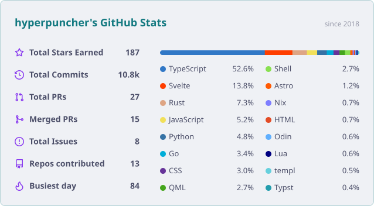

# github stats card

One GitHub Action that renders a single self-theming stats card as SVG. One GraphQL call, no npm, no runtime, nothing third-party holding your token.



That image is the real output, generated by this action from the default palette pair. It carries its own `prefers-color-scheme` query, so this one file follows your light or dark theme. No `<picture>` block, no second file.

## quick start

Add `.github/workflows/card.yml` to your **profile repository** (`username/username`):

```yaml
name: Update card

on:
  schedule:
    - cron: "17 4 * * *" # daily, avoid :00 when the queue is busy
  workflow_dispatch:

permissions: {}

concurrency:
  group: card
  cancel-in-progress: false

jobs:
  card:
    runs-on: ubuntu-slim
    timeout-minutes: 10
    permissions:
      contents: write
    env:
      GH_TOKEN: ${{ github.token }}
    steps:
      - uses: hyperpuncher/stats@v1
        with:
          theme: catppuccin_latte aura
          token: ${{ secrets.STATS_TOKEN || github.token }}
          # exclude_repos: some-repo

      # publish to a branch, as a commit with no parent, so the branch is always
      # one commit deep and your default branch and contribution graph stay clean
      - name: Publish
        run: |
          set -euo pipefail
          blob=$(gh api "repos/$GITHUB_REPOSITORY/git/blobs" \
            -f content="$(base64 -w0 profile/card.svg)" -f encoding=base64 --jq .sha)
          tree=$(gh api "repos/$GITHUB_REPOSITORY/git/trees" \
            -f "tree[][path]=card.svg" -f "tree[][mode]=100644" \
            -f "tree[][type]=blob" -f "tree[][sha]=$blob" --jq .sha)
          commit=$(gh api "repos/$GITHUB_REPOSITORY/git/commits" \
            -f message="chore: update card" -f tree="$tree" --jq .sha)
          gh api -X PATCH "repos/$GITHUB_REPOSITORY/git/refs/heads/card" \
            -f sha="$commit" -F force=true 2>/dev/null \
            || gh api -X POST "repos/$GITHUB_REPOSITORY/git/refs" \
              -f ref=refs/heads/card -f sha="$commit"
```

Then in your README, pointing at the branch:

```md

```

**why a branch and not the default branch.** commits, stars and language bytes move most days, so a daily card in your default branch is ~365 bot commits a year in the history you actually look at. on a `card` branch they cost nothing: the branch is rewritten as a single parentless commit each run, so it never grows past one commit, GitHub garbage-collects the replaced ones, and non-default branches don't appear in your contribution graph at all. raw.githubusercontent caches for a few minutes, so a reader may briefly see the previous card after a run.

## inputs

| name            | default                 |                                                     |
| --------------- | ----------------------- | --------------------------------------------------- |
| `username`      | the repository owner    | whose stats to render                               |
| `output`        | `profile/card.svg`      | where to write it                                   |
| `theme`         | `catppuccin_latte aura` | light palette, then dark. one name uses it for both |
| `langs_count`   | `16`                    | how many languages to list                          |
| `exclude_repos` | none                    | space separated repo names to skip                  |
| `token`         | `github.token`          | read access to the repos you want counted           |

outputs: `path`, the file that was written.

## token

All public repos need **nothing**: `github.token` reads your public data. Private repos need one secret, a fine-grained PAT with read-only `Contents` + `Metadata`, passed as `token:`. Never a classic PAT with `repo` scope, which is read _and write_ on everything you can reach.

The action only reads and never writes to your repository, so a bad future release could leak what your token can already read but cannot push anything. If that matters, use a commit SHA instead of `v1`.

## themes

`aura`, `catppuccin_latte`, `catppuccin_mocha`, `tokyonight`, `dracula`, `radical`, `gruvbox`, `onedark`, `github_dark`, `nord`, `synthwave`, `cobalt`, `monokai`, `ocean_dark`, `rose_pine`.

Colours match github-readme-stats, so names mean what you expect. To add one, append a `name:bg:title:text:icon` line to `CATALOG` in `gen.sh`.

## or just copy the script

If you'd rather not point a workflow at someone else's repository, copy `gen.sh` into your profile repo and swap the `uses:` line for:

```yaml
- run: ./gen.sh "${{ github.repository_owner }}" profile/card.svg
  env:
    GH_TOKEN: ${{ secrets.STATS_TOKEN || github.token }}
```

That is the whole tool: one readable file calling `gh` and `jq`, both already on the runner. It needs `bash`, `gh` and `jq`, which every GitHub runner has, or `gh auth login` for local runs.

## notes

- **100 repos per year** is a GitHub ceiling, not a setting: `first` and `maxRepositories` both reject more. A year where you touched over 100 repos would undercount.
- **Safari** is the engine where `prefers-color-scheme` inside SVG-as-image has historically lagged. If it fails, those readers get the light palette permanently, which is legible rather than broken.
- The value column is sized from measured label widths for `system-ui`; rename a label in `gen.sh` and re-measure, or the longest label can collide with its value.

MIT. The five octicon paths and the palette values come from [github-stats-extended](https://github.com/stats-organization/github-stats-extended) and [octicons](https://github.com/primer/octicons), both MIT.
